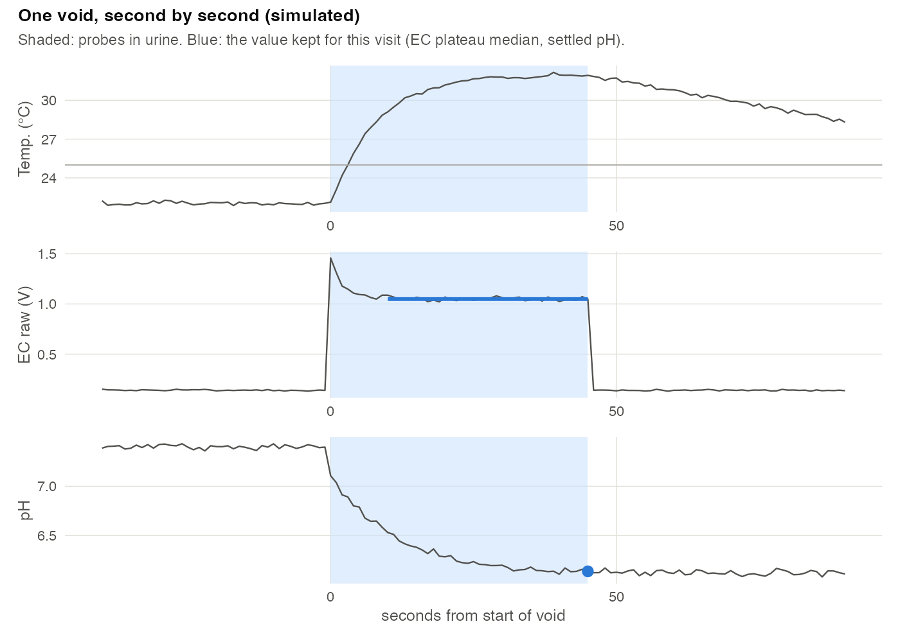
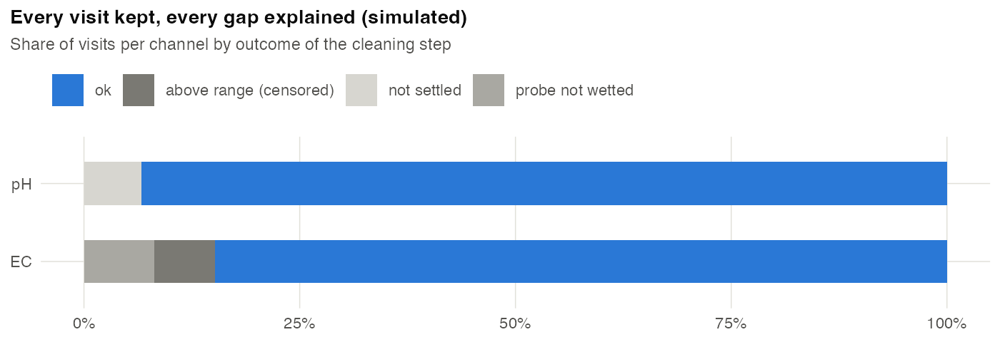
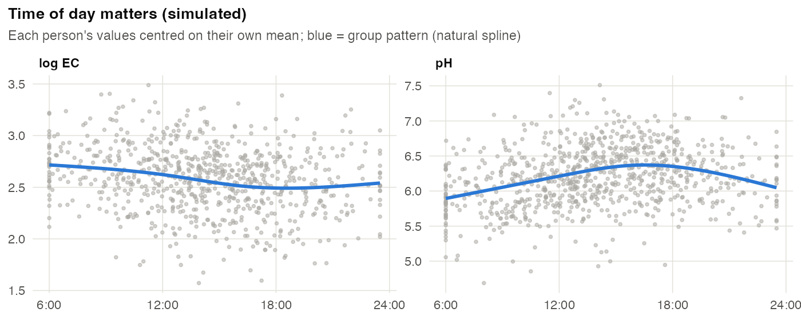
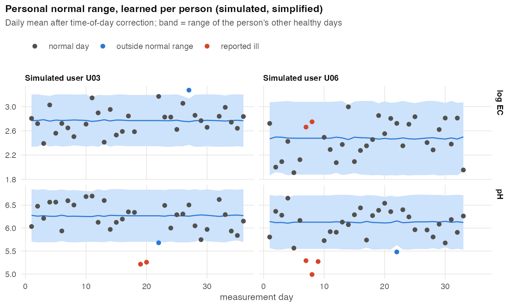

# SmartWC: analysis demo

[SmartWC](https://swcbase.ch) is a sensor that clips onto an ordinary toilet
and measures urine pH and conductivity (EC, a proxy for concentration) at
every visit. Instead of comparing people with population reference ranges,
it learns each person's own normal range and flags days that fall outside it.

This repository shows how the analysis is built, on **simulated data only**.
It contains no measurements, no participant information and no production code.

## Figures

**One void, second by second.** The sensor logs every second. A visit's
value comes only from the window in which the probes are actually in urine.
EC is taken as the plateau median; pH electrodes settle slowly, so pH is read
at the end of the window.



**Every visit kept, every gap explained.** Cleaning flags problems instead of
deleting visits: probe not wetted, value above the measurable range
(censored, not missing), or a pH reading that ended before the electrode had
settled. Only double taps (one void logged twice) are removed.



**Time of day matters.** Urine is typically more concentrated and more acidic
in the morning. Without a correction, someone who mostly visits in the
morning would look "abnormal" on an afternoon.



**Personal normal range.** Each day is compared with the same person's other
healthy days, not with other people. In the simulation two users have a short
illness; those days fall outside their personal range.



## Method

Values are corrected for time of day, each person gets a personal baseline,
and every day is scored by how far it deviates from that baseline.

For reasons of information security, the full analysis method used in
SmartWC is not described publicly. Figure 4 uses a deliberately simplified
stand-in (mean ± 2 SD of the person's other healthy days) to illustrate the
idea.

## Run it

```bash
Rscript R/00_simulate.R   # fictional users -> data/
Rscript R/01_clean.R      # cleaning -> data/visits_clean.csv
Rscript R/02_figures.R    # -> figures/
```

Requires R with `tidyverse`, `splines` and `patchwork`.
